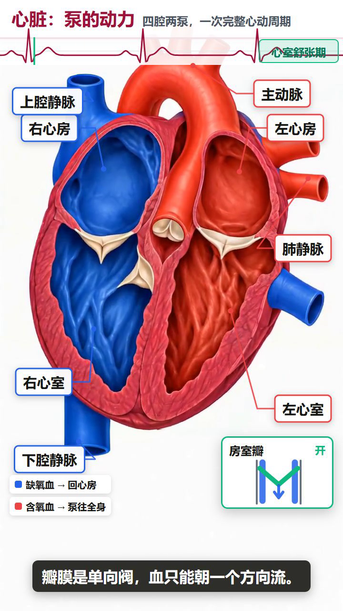

# stem-explainer-video

> 用 AI 做**结构准确**的 STEM 科普视频。

给一个科学原理，产出一条**图准、字对、声音清楚**的讲解视频。

 
**看效果**：[`examples/heart-ai/heart-ai-route.mp4`](./examples/heart-ai/heart-ai-route.mp4)
（28 秒竖屏成片，3 拍里只有 1 拍用了 AI 视频）



B站视频： https://www.bilibili.com/video/BV1qfxS6TEev/?vd_source=86926e418c83af75f6850b5546388a79


---

## 这个 skill 解决什么问题

做科普视频最容易踩的三个坑：

| 坑 | 表现 | 本 skill 怎么解 |
|---|---|---|
| **图不准** | 剖面图画成了另一个结构，箭头方向反了 | 底图交给最擅长画结构的中文生图模型，提示词有强制规范 |
| **动坏了** | 视频一生成，原图的结构和标签全变形 | 用底图当**首帧**驱动动画，实测结构 100% 保真 |
| **字幕错字** | AI 把中文标签改成乱码 | 字幕完全不交给 AI，由代码确定性渲染 |

还有一个大多数人会踩的坑：

| 坑 | 表现 | 本 skill 怎么解 |
|---|---|---|
| **烧钱** | 每拍都生成 AI 视频，一集花掉十几块 | **动效分层**：只有「运动本身是知识点」的拍才用 AI，其余 0 成本 |

做法是把视频拆成四层，每层只干自己擅长的事：

```
第 1 层  底图    AI 生图      画出结构准确的中文示意图
第 2 层  动画    MiniMax H3   以底图为首帧，让它动起来
第 3 层  文字    Remotion     用代码叠加字幕/术语卡/标注
第 4 层  旁白    apiz speak   配音
```

---

## 快速开始

### 0. 检查环境

```bash
python scripts/lib_apiz.py
```

会打印 apiz 位置、鉴权状态、余额。看到「鉴权: OK」就成了。

### 1. 复制示例

```bash
cp -r examples/pipe-valve my-episode
cd my-episode
```

### 2. 改 plan.json

这是**唯一要改的文件**。里面写清楚每一拍讲什么、画面长什么样、什么在动。

```json
{
  "id": "s01",
  "duration_sec": 7,
  "narration": "打开你家卫生间的水龙头，水就顺着管道流出来了。",
  "caption": "水龙头一开，水就顺着管道流出来了",
  "term": "管道",
  "term_def": "输送流体的通道",
  "diagram":   {"prompt": "这里写底图提示词"},
  "animation": {"prompt": "这里写动画提示词", "duration": 7}
}
```

字段逐个解释见 [`references/plan-format.md`](references/plan-format.md)。

### 3. 跑

```bash
python ../scripts/run_episode.py plan.json
```

出来 `out/episode.mp4`。

---

## 三个提示词怎么写

这是整个 skill 里最需要动脑的部分。三份规范都在 `references/` 里，
写之前读一遍，能省掉大部分返工。

### 底图提示词：9 段结构

```
类型    Clean flat vector Chinese science textbook diagram
主体    a HORIZONTAL pipe running left to right, cut-open cross-section
布局    vertical portrait, subject centered in the upper two-thirds
风格    flat vector, textbook illustration, no 3D, no photo texture
配色    water #2563eb, pipe walls #6b7280, valve #ef4444
标签    bold black Chinese labels with thin leader lines: 管道, 水流, 阀门
质量    publication-ready, clean crisp outlines, high contrast
禁止    no watermark, no extra text, no garbled characters, nothing cropped
背景    pure white background #FFFFFF
```

完整规范（10 条铁律 + 中文标签写法 + 构图规范）→
[`references/diagram-rules.md`](references/diagram-rules.md)

**三条最容易翻车的**：

1. **中文标签要逐个点名。** 写「加上适当的标签」，模型会自己发明词。
   必须写 `labels: 管道, 水流, 阀门`。
2. **竖屏会改朝向。** 横管要显式写 `the pipe is HORIZONTAL running left to right`，
   否则会被画成竖管。
3. **底部要留白。** 字幕要叠在下面，写 `generous empty margin at the bottom`。

### 动画提示词：三句话

```
<什么在动，怎么动>，
<什么必须保持不动>，
<镜头与风格约束>。
```

```
The blue water inside the pipe flows steadily from left to right with smooth
continuous motion. Everything else stays perfectly static, sharp and unchanged:
the pipe geometry, all Chinese labels 管道 水流 阀门, outlines, colors.
Locked camera, flat vector educational animation, no distortion, no text change.
```

**「什么保持不动」这句不能省。** 写了它，首帧的结构和标签实测 100% 保真。

### 旁白：问题驱动

不要写成「阀门是一种管道配件，用于控制流体通断的装置」——
这是念书。改成：

> 管道中间这个红色手轮，叫阀门。它的作用不是让水流得更快，
> 而是在需要的时候把这一段管道彻底关上。

完整讲稿规范（问题链、例子密度、启发点）→
[`references/teaching-script.md`](references/teaching-script.md)

---

## 24 个 STEM 场景模板

`references/templates/` 下有 24 个现成模板，按场景编号：

信号通路、实验流程、细胞结构、数据信息图、学术海报、概念信息图、
科学史时间线、对比矩阵、截面剖视、中心辐射、层级树、循环流程、
多子图、质粒图、机械示意、物理原理、化学结构、数学概念、图文摘要、
实验室安全、教学海报、步骤说明、架构图、双语图。

每个模板带 `prompt_template`（9 段式）、`variants`（学术/教材/信息图/3D）、
`category_tips`（学科专属提示）、`accuracy_tips`（准确性红线）。

挑模板：

```bash
python - <<'EOF'
import json, glob
for f in sorted(glob.glob('references/templates/*.json')):
    d = json.load(open(f, encoding='utf-8'))
    print(f"{d['id']:<24} {d['name']}")
EOF
```

---

## 成本控制：动效分层（**最重要，先看这个**）

**AI 视频只在「运动本身就是知识点」时才必要。**

科普片里大多数镜头，观众看的是**结构**（这是什么、部件在哪），
不是**运动**。这时候用 AI 生成视频是纯浪费 —— 花钱、耗时，
还会把观众注意力从结构上带走。

| 层 | `motion.type` | 手段 | 成本 | 用在什么镜头 |
|---|---|---|---|---|
| 静止层 | `still` | 静态底图 + 代码动效（推镜/高亮/标注） | **0** | 结构图、剖面图、流程图、对比图 |
| 精确层 | `precise` | 代码渲染的确定性动画 | **0** | AI 做不了的精确状态变更 |
| AI 层 | `ai` | minimax/h3 首帧驱动 | **79 积分/段** | **只有**运动本身是知识点时 |

**AI 视频的合理占比：15%~30%。超过 50% 基本在浪费钱。**

### 怎么判断

1. **换成静态图 + 高亮框，观众还懂吗？** → 懂就用 `still`
2. **这个运动本身是知识点吗？**（流体流动 / 阀门开启 / 分子振动 / 相变 / 爆炸展开）
   → 是才用 `ai`
3. **这个运动有精确起止状态吗？** → 有就用 `precise`

### 静止层不是「一张死图」

`still` 有三种代码动效，可叠加：

```json
"motion": {
  "type": "still",
  "zoomTo": {"x": 500, "y": 220, "scale": 1.25},
  "highlight": {
    "x": 500, "y": 220, "w": 190, "h": 130,
    "label": "阀门手轮", "delay": 1.2, "duration": 4.5,
    "color": "#ef4444"
  }
}
```

- **推镜**：把视线收到该看的地方
- **高亮框**：精确指向正在讲的部件（**AI 做不到这么准**）
- **标注层**：多个标注按旁白节奏依次出现

### 更进一步：整段代码场景（**复杂科普动效，0 积分**）

上面三层解决的是「一拍的动效」。当一个主题需要**连续、严格按相位同步**的复杂运动时
（心动周期、振荡、循环流动、相位耦合），正确做法不是调 AI 视频参数，而是
**直接写一个 Remotion 组件，把整个场景用 SVG + `useCurrentFrame()` 画出来**。

样片：**`examples/heart/`** —— 心脏的复杂工作原理，12.25 秒，**0 积分**
（没生图、没 AI 视频，只有 edge-tts 配音）。

它做到了：

- 四个腔室按心动周期**搏动**（心房缩、心室缩，腔变小而壁变厚）
- 四个瓣膜**按相位开合**（房室瓣与半月瓣严格互斥）
- **红蓝双回路血流**：蓝=缺氧血（体→右心→肺），红=含氧血（肺→左心→全身），
  亮滴沿路径流动，射血期只走动脉、舒张期只走静脉
- **心电（ECG）滚动**，R 峰对准心室收缩起点
- 顶部**实时相位标签** + 底部**瓣膜开/关状态面板**

判断口径：

> 运动有**确定的周期相位和确定的起止状态** → **代码写**（免费、几何永远正确）
> 运动**没有确定状态**、纯有机质感（湍流、燃烧、粒子弥散）→ **AI 生成**（花钱但值得）

心脏正好属于前者：房缩必先于室缩、动脉瓣必晚于房室瓣关，这些必须严格对齐，
交给 AI 反而会让血液流向乱、收缩顺序错。

源码 `templates/remotion-project/src/HeartCycle.tsx`，
踩坑与可复用套路见 `examples/heart/README.md`。

### 成本对比（15 拍一集）

| 方案 | AI 视频拍数 | 合计 |
|---|---|---|
| ❌ 每拍都 AI | 15 | **≈ 12.0 元** |
| ✅ 分层（4 拍真需要） | 4 | **≈ 3.4 元**（省 72%） |
| ✅ 分层（2 拍真需要） | 2 | **≈ 1.8 元**（省 85%） |

### 花钱前先算账

```bash
python scripts/estimate_cost.py plan.json
```

输出总成本，并与「每拍都用 AI」对比。AI 占比过高会明确警告。

### 流程上的强制卡点

- `gen_animations.py` **只处理** `motion.type == 'ai'` 的拍，其余直接跳过
- `plan_schema.py` 校验：`still` 却写了 `animation.prompt` → 报错（浪费）
- `build_storyboard.py` 打印实际动效分布与成本

> **实战教训**：本 skill 早期版本把「每拍都出 AI 视频」写死了。
> 跑一个 3 拍测试就烧掉 91 积分，其中 **73% 花在「静态图就够」的镜头上**。

详见 [`references/motion-layers.md`](references/motion-layers.md)。

---

## 成本明细

| 环节 | 单价 | 15 拍 × 6 秒（全部 AI） |
|---|---|---|
| 底图 | 6 积分/张 | 90 |
| 动画 480p | 79 积分/段 | 1185 |
| 配音 | ~1 积分/句 | ~15 |
| 合计 | | **≈ 12.9 元** |

分层后通常只有 2~5 拍用 AI 视频，实际花费 **≈ 2~4 元**。

> **省钱的做法**：先用 `480p` 跑通全片确认内容，
> 再只把视频层用 `768P` 重跑一遍（底图和配音复用）：
>
> ```bash
> python ../scripts/run_episode.py plan.json --skip-diagrams --skip-narration --resolution 768P
> ```

---

## 完整命令

```bash
# 花钱前先看账（强烈建议先跑）
python scripts/estimate_cost.py plan.json

# 一键全流程
python scripts/run_episode.py plan.json

# 分步（便于调试）
python scripts/gen_diagrams.py    plan.json   # 底图
python scripts/gen_animations.py  plan.json   # 动画（只处理 motion.type='ai' 的拍）
python scripts/gen_narration.py   plan.json   # 配音
python scripts/fit_duration.py    plan.json   # 时长对齐（视频比旁白短时循环补齐）
python scripts/build_storyboard.py plan.json  # 组装
python scripts/render_episode.py  plan.json   # 渲染
python scripts/verify_media.py    plan.json --video out/episode.mp4   # 质检

# 只重跑某几拍
python scripts/gen_diagrams.py plan.json --only s03,s04
python scripts/gen_animations.py plan.json --only s03 --force

# 校验 plan
python scripts/plan_schema.py plan.json
```

---

## 质检会查什么

`verify_media.py` 做四件事，其中第 3 条是**别的工具查不出来的**：

1. 每拍素材齐全（视频 + 音频）
2. 每拍视频时长 ≥ 旁白时长（防止「话没说完画面就切走」）
3. **音频波形体检** —— 把音轨切成 0.5 秒窗算 RMS，
   检查有声窗占比 > 95%、静音段都短于 2 秒
   （⚠️ ffprobe 时长一致、媒体探测报 PASS，都**查不出音轨损坏**）
4. 整片音视频时长差 < 0.5 秒

---

## 这个 skill **不能**做什么

AI 生图是**模式匹配器**，不是几何引擎。它能画「看起来对」，
但画不出「真的对」。

### ✅ 适合交给 AI

概念示意图、流程图、剖面图、信号通路、细胞结构、教学插图、信息图

### ❌ 必须用代码生成

- **数学严格证明图**（勾股定理、几何证明、向量/矩阵图）
- **坐标图、函数图像**（抛物线、正弦曲线）
- **精确构造图**（内接多边形、角平分线、相似三角形）
- **精确键长角度的电路图、化学结构式**
- **真实实验数据图**（散点/柱状/折线/热图）

→ 这类题目：手工用 matplotlib 画好底图，命名成
`assets/diagrams/<拍号>.png`，后续流程（动画/配音/渲染）**完全不用改**。

还有一个边界：**AI 对细微机械状态不敏感**。
实测让它把阀门手轮转开，手轮根本没动（其他部分全对）。
精确的状态变更要靠代码画，不能指望 AI 改图。

---

## 项目结构

```
stem-explainer-video/
├── SKILL.md                      # 给 AI 读的工作流说明
├── README.md                     # 本文件
├── references/
│   ├── diagram-rules.md          # 底图提示词规范
│   ├── api-handbook.md           # apiz / H3 API 手册（含全部踩坑）
│   ├── teaching-script.md        # 科普讲稿规范
│   ├── motion-layers.md          # ★ 动效分层与成本控制
│   ├── plan-format.md            # plan.json 字段说明
│   └── templates/                # 24 个 STEM 场景模板
├── scripts/
│   ├── lib_apiz.py               # apiz 封装（图片/视频/上传/配音）
│   ├── plan_schema.py            # plan 校验
│   ├── estimate_cost.py          # ★ 花钱前的成本预估
│   ├── gen_diagrams.py           # 第1层 底图
│   ├── gen_animations.py         # 第2层 动画（只处理 motion.type='ai'）
│   ├── gen_narration.py          # 第3层 配音
│   ├── fit_duration.py           # 时长对齐（防止话没说完就切画面）
│   ├── build_storyboard.py       # 第4层 组装
│   ├── render_episode.py         # Remotion 渲染
│   ├── verify_media.py           # 质检（含音频波形体检）
│   └── run_episode.py            # 一键串联
├── templates/remotion-project/   # Remotion 工程模板
└── examples/pipe-valve/          # 完整可跑示例（3 拍，只有 1 拍用 AI 视频）
```

**自包含**：整个 skill 不引用任何外部文件，所有依赖都在目录内，
可以直接 clone 到 GitHub 使用。

---

## 环境要求

| 依赖 | 版本 | 说明 |
|---|---|---|
| `apiz` CLI | — | 已安装并登录。Windows 上常在 `~/.local/bin`，可用 `APIZ_BIN` 指定 |
| Python | 3.10+ | 只用标准库，不需要 pip install |
| `ffmpeg` / `ffprobe` | — | 合成与质检 |
| `node` / `npm` | node ≥ 20 | Remotion 渲染 |
| Chrome | — | Remotion 内核，自动探测常见安装路径 |

首次渲染会自动 `npm install`（几分钟）。

---

## 常见问题

**Q: `apiz: command not found`（Windows）**
设环境变量 `APIZ_BIN`，或把 `~/.local/bin` 加进 PATH。

**Q: 底图比例不对，全是横的**
图片模型要用 `--image-size "9:16"`，**不是** `--aspect-ratio`。
脚本已处理，手工调用时注意。

**Q: 传了首帧，但视频第一帧是纯白**
首帧必须写在 `content` 数组里并带 `role: "first_frame"`。
放在顶层会被**静默忽略**。详见 `references/api-handbook.md`。

**Q: 视频一生成，图上的中文标签全乱了**
动画提示词里加上「所有中文标签保持完全静止、不变」，并加 `no text change`。

**Q: 画面比说的慢半拍**
`animation.duration` 和 `duration_sec` 不一致。校验脚本会报出来。

**Q: 整片某一段没声音**
跑 `verify_media.py`，它会算波形找出静音段。

---

## License

MIT

致谢： https://linux.do 社区